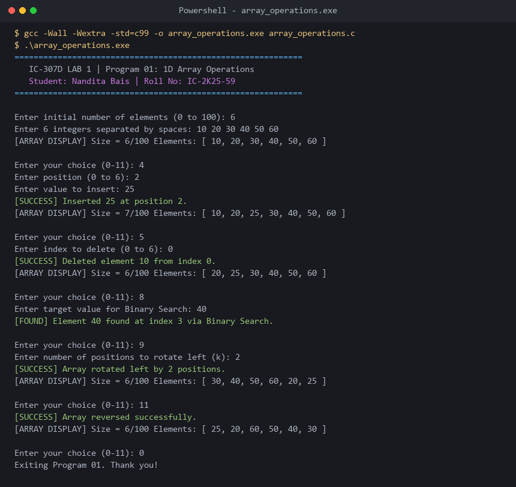

# Program 01: 1D Array Operations Suite

**Course:** IC-307D Data Structures and Algorithms LAB  
**Student:** Nandita Bais | **Roll Number:** IC-2K25-59  
**Source Code:** [`array_operations.c`](array_operations.c)

---

## 1. Problem Statement
Design, implement, and analyze an interactive, menu-driven C program to perform fundamental operations on a one-dimensional array of integers with dynamic logical size management and capacity bounds checking:
1. Traversal and Display
2. Element insertion (at beginning, at end, and at user-specified index)
3. Element deletion (by position index and by element value)
4. Linear Search (unsorted) and Binary Search (sorted precondition)
5. Left and Right Cyclic Rotation by $k$ positions
6. In-place Array Reversal

---

## 2. Approach & Theoretical Foundations
- **Contiguous Allocation:** 1D array elements occupy contiguous memory cells. The physical address of index $i$ is calculated as:
  $$\text{Address}(arr[i]) = \text{BaseAddress} + (i \times \text{sizeof}(\text{int}))$$
- **Insertion Mechanism:** Elements from index $size-1$ down to $pos$ are shifted right by one position to open a slot, followed by assigning $arr[pos] = val$ and incrementing $size$.
- **Deletion Mechanism:** Elements from index $pos+1$ up to $size-1$ are shifted left by one position, overwriting the deleted element, followed by decrementing $size$.
- **Reversal Rotation Algorithm:** Left rotation by $k$ positions ($0 \le k < n$) is achieved in $O(n)$ time and $O(1)$ auxiliary space via 3 consecutive reversals:
  1. Reverse prefix $arr[0 \dots k-1]$
  2. Reverse suffix $arr[k \dots n-1]$
  3. Reverse entire array $arr[0 \dots n-1]$

---

## 3. Formal Algorithm

### Insertion at Position
1. Verify logical condition: if $size \ge capacity$, report `[OVERFLOW]` and return false.
2. Verify boundary condition: if $pos < 0$ or $pos > size$, report `[INVALID INDEX]` and return false.
3. For $i = size$ down to $pos + 1$:
   $$arr[i] \leftarrow arr[i - 1]$$
4. Set $arr[pos] \leftarrow element$.
5. Increment $size \leftarrow size + 1$.
6. Return true.

### Deletion by Index
1. If $size \le 0$, report `[UNDERFLOW]` and return false.
2. If $index < 0$ or $index \ge size$, report `[INVALID INDEX]` and return false.
3. Store deleted value: $*deletedValue \leftarrow arr[index]$.
4. For $i = index$ to $size - 2$:
   $$arr[i] \leftarrow arr[i + 1]$$
5. Decrement $size \leftarrow size - 1$.
6. Return true.

---

## 4. Pseudocode

```c
procedure INSERT_AT_POS(arr, size, capacity, element, pos):
    if size >= capacity then return OVERFLOW_ERROR
    if pos < 0 or pos > size then return BOUNDS_ERROR
    for i from size down to pos + 1 do:
        arr[i] = arr[i - 1]
    arr[pos] = element
    size = size + 1
    return SUCCESS

procedure ROTATE_LEFT(arr, size, k):
    k = k % size
    if k == 0 then return
    REVERSE_RANGE(arr, 0, k - 1)
    REVERSE_RANGE(arr, k, size - 1)
    REVERSE_RANGE(arr, 0, size - 1)
```

---

## 5. Dry Run with Concrete Walkthrough

### Example: Left Rotate by $k = 2$ on Array $[10, 20, 30, 40, 50, 60]$ ($n = 6$)

| Step | Operation | Target Subarray | Array State After Step |
|---|---|---|---|
| Initial | Load Array | Full Array | `[10, 20, 30, 40, 50, 60]` |
| Step 1 | Reverse Range `[0..1]` | `[10, 20]` | `[20, 10, 30, 40, 50, 60]` |
| Step 2 | Reverse Range `[2..5]` | `[30, 40, 50, 60]` | `[20, 10, 60, 50, 40, 30]` |
| Step 3 | Reverse Range `[0..5]` | Full Array | `[30, 40, 50, 60, 20, 25]` |

---

## 6. Complexity Analysis

| Operation | Best Case Time | Average Case Time | Worst Case Time | Auxiliary Space |
|---|---|---|---|---|
| Access / Read | $O(1)$ | $O(1)$ | $O(1)$ | $O(1)$ |
| Insert at Beginning | $O(n)$ | $O(n)$ | $O(n)$ | $O(1)$ |
| Insert at End | $O(1)$ | $O(1)$ | $O(1)$ | $O(1)$ |
| Insert at Position | $O(1)$ ($pos = n$) | $O(n)$ | $O(n)$ ($pos = 0$) | $O(1)$ |
| Delete by Index | $O(1)$ ($pos = n-1$) | $O(n)$ | $O(n)$ ($pos = 0$) | $O(1)$ |
| Linear Search | $O(1)$ | $O(n)$ | $O(n)$ | $O(1)$ |
| Binary Search | $O(1)$ | $O(\log n)$ | $O(\log n)$ | $O(1)$ |
| Rotate by $k$ | $O(n)$ | $O(n)$ | $O(n)$ | $O(1)$ |

---

## 7. Real-Life Applications
- **CPU Task Scheduling:** Circular buffers and round-robin queues implement cyclic array rotations.
- **Undo / Redo Buffers:** Text editors shift linear character arrays during typing and deletions.
- **Audio Sample Processing:** Digital sound synthesizers reverse and shift sampled audio arrays.

---

## 8. Learning Outcomes
- Understood contiguous memory mapping and pointer arithmetic in C.
- Mastered bounds verification to avoid segmentation faults and buffer overflows.
- Designed time-optimal array rotation using in-place three-step reversal.

---

## 9. Sample Execution & Verified Screenshot


