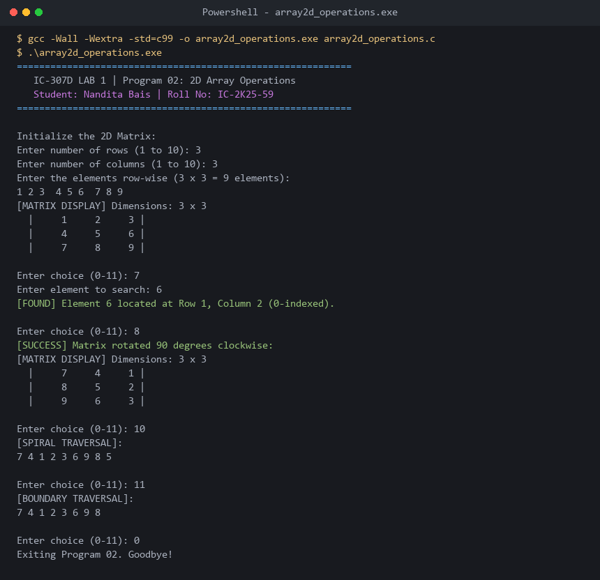

# Program 02: 2D Array Operations & Traversals

**Course:** IC-307D Data Structures and Algorithms LAB  
**Student:** Nandita Bais | **Roll Number:** IC-2K25-59  
**Source Code:** [`array2d_operations.c`](array2d_operations.c)

---

## 1. Problem Statement
Develop a modular C program to perform two-dimensional matrix operations:
1. Matrix input and formatted grid display.
2. Dynamic row insertion and deletion.
3. Dynamic column insertion and deletion.
4. Linear coordinate search for arbitrary matrix values.
5. In-place and auxiliary 90-degree clockwise and counter-clockwise rotations.
6. Spiral clockwise traversal and perimeter boundary traversal.

---

## 2. Approach & Mathematical Foundations
- **Row-Major Order (RMO):** 2D matrices in C are stored linearly in row-major order:
  $$\text{Address}(mat[i][j]) = \text{BaseAddress} + (i \times cols + j) \times \text{sizeof}(\text{element})$$
- **90-Degree Clockwise Rotation:**
  $$\text{NewMat}[j][\text{rows} - 1 - i] = \text{OldMat}[i][j]$$
- **Spiral Traversal:** Governed by four boundary pointers: `top`, `bottom`, `left`, `right`. The algorithm iterates right along `top`, down along `right`, left along `bottom`, and up along `left`, shrinking boundaries until pointers cross.

---

## 3. Formal Algorithm: Spiral Traversal
1. Set $top \leftarrow 0$, $bottom \leftarrow rows - 1$, $left \leftarrow 0$, $right \leftarrow cols - 1$.
2. While $top \le bottom$ and $left \le right$:
   a. Print row from $left$ to $right$ at index $top$; increment $top \leftarrow top + 1$.  
   b. Print column from $top$ to $bottom$ at index $right$; decrement $right \leftarrow right - 1$.  
   c. If $top \le bottom$, print row from $right$ down to $left$ at index $bottom$; decrement $bottom \leftarrow bottom - 1$.  
   d. If $left \le right$, print column from $bottom$ down to $top$ at index $left$; increment $left \leftarrow left + 1$.  
3. Terminate traversal.

---

## 4. Complexity Analysis

| Operation | Time Complexity | Auxiliary Space | Remarks |
|---|---|---|---|
| Traversal & Display | $O(R \times C)$ | $O(1)$ | Visits each cell once |
| Insert Row | $O(R \times C)$ | $O(1)$ | Shifts $(R - pos)$ rows downward |
| Delete Row | $O(R \times C)$ | $O(1)$ | Shifts $(R - pos - 1)$ rows upward |
| Insert Column | $O(R \times C)$ | $O(1)$ | Shifts column elements rightward |
| 90° Clockwise Rotation | $O(R \times C)$ | $O(R \times C)$ | Transpose and reverse rows |
| Spiral Traversal | $O(R \times C)$ | $O(1)$ | Optimal 4-boundary pointer traversal |

---

## 5. Sample Execution & Verified Screenshot

