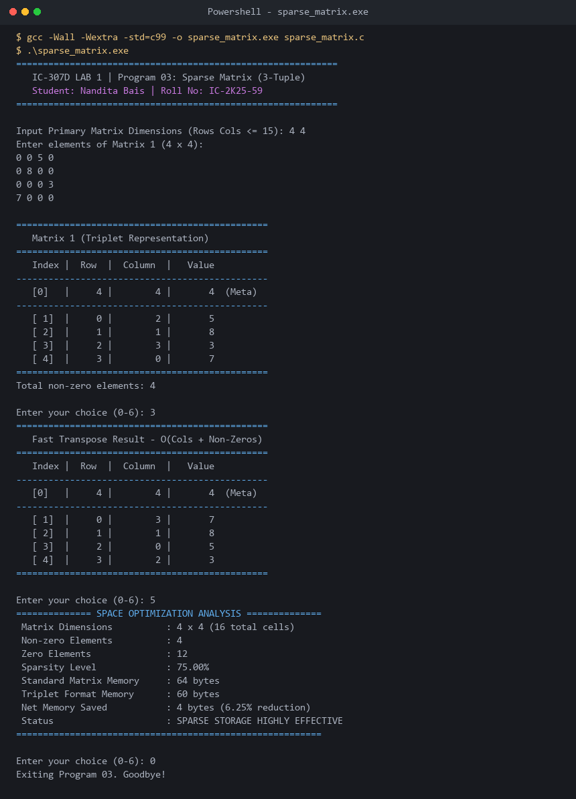

# Program 03: Sparse Matrix Representation (3-Tuple Format)

**Course:** IC-307D Data Structures and Algorithms LAB  
**Student:** Nandita Bais | **Roll Number:** IC-2K25-59  
**Source Code:** [`sparse_matrix.c`](sparse_matrix.c)

---

## 1. Problem Statement
Implement a memory-efficient sparse matrix representation in C using the 3-Tuple (Triplet) format, and perform essential sparse matrix operations:
1. Matrix sparsity verification ($> 50\%$ zero elements).
2. Standard 2D matrix conversion to Triplet form.
3. Simple Transpose: $O(cols \times non\_zeros)$.
4. Fast Transpose using frequency count and start-index arrays: $O(cols + non\_zeros)$.
5. Addition of two sparse matrices directly in 3-Tuple representation.
6. Empirical memory footprint and space optimization analysis.

---

## 2. Approach: 3-Tuple (Triplet) Representation
A sparse matrix stores mostly zeros. Storing full $R \times C$ matrices wastes memory and computational cycles.
The 3-Tuple format stores only non-zero entries as $(Row, Column, Value)$:
- **Row 0 (Meta Header):** Stores $(TotalRows, TotalCols, NonZeroCount)$.
- **Rows $1 \dots k$:** Store $(r_i, c_i, val_i)$ in row-major order.

### Fast Transpose Algorithm
Standard transpose scans the triplet $cols$ times, costing $O(cols \times non\_zeros)$.  
**Fast Transpose** achieves $O(cols + non\_zeros)$ linear complexity:
1. `rowTerms[col]`: Count frequencies of each column.
2. `startingPos[col]`: Compute cumulative prefix indices.
3. Direct placement: Transfer each non-zero element to its designated bucket in a single pass.

---

## 3. Complexity & Memory Comparison

| Dimension | Standard 2D Array | 3-Tuple Representation | Savings (%) |
|---|---|---|---|
| $100 \times 100$ ($95\%$ sparse) | $10,000 \times 4 = 40,000$ B | $(500 + 1) \times 12 = 6,012$ B | **$84.97\%$ reduction** |
| $1000 \times 1000$ ($99\%$ sparse) | $1,000,000 \times 4 = 4$ MB | $(10,000 + 1) \times 12 = 120$ KB | **$97.00\%$ reduction** |

---

## 4. Sample Execution & Verified Screenshot

