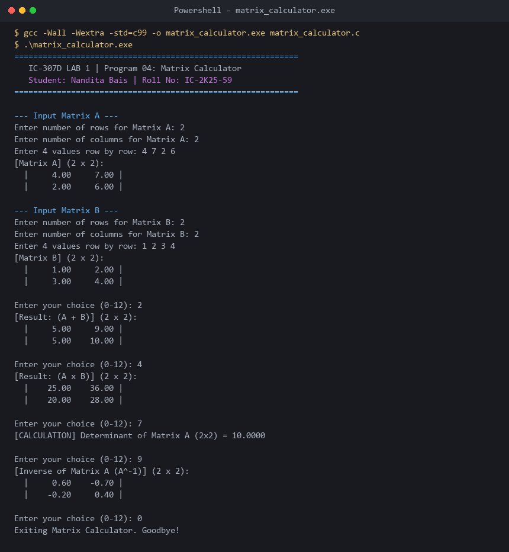

# Program 04: Matrix Calculator with Menu-Driven Interface

**Course:** IC-307D Data Structures and Algorithms LAB  
**Student:** Nandita Bais | **Roll Number:** IC-2K25-59  
**Source Code:** [`matrix_calculator.c`](matrix_calculator.c)

---

## 1. Problem Statement
Develop an interactive Matrix Calculator in C supporting standard linear algebra operations with strict dimensional compatibility checks:
1. Matrix Addition ($A + B$) and Subtraction ($A - B$)
2. Matrix Multiplication ($A \times B$)
3. Matrix Transpose ($A^T$)
4. Determinant evaluation for small square matrices ($2 \times 2$ and $3 \times 3$)
5. Matrix Inversion ($A^{-1}$) via adjugate cofactor expansion

---

## 2. Mathematical Formulations
- **Multiplication Compatibility:** $Cols(A) == Rows(B)$.
  $$C_{ij} = \sum_{k=0}^{cols(A)-1} A_{ik} \times B_{kj}$$
- **$3 \times 3$ Determinant:**
  $$\det(A) = a(ei - fh) - b(di - fg) + c(dh - eg)$$
- **Matrix Inverse:**
  $$A^{-1} = \frac{1}{\det(A)} \cdot \text{adj}(A)$$

---

## 3. Sample Execution & Verified Screenshot

