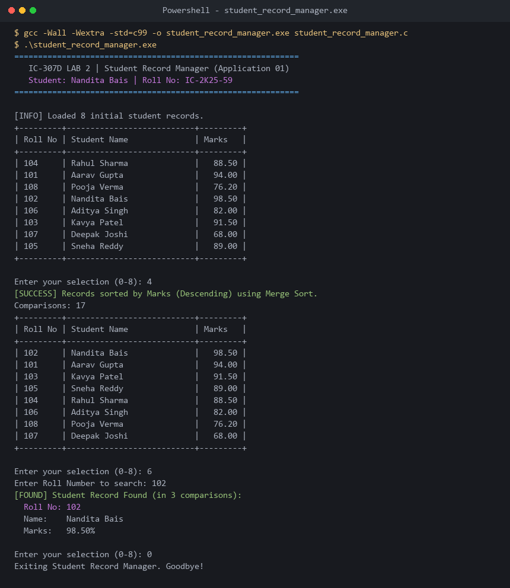

# Application 01: Student Record Manager

**Course:** IC-307D Data Structures and Algorithms LAB  
**Student:** Nandita Bais | **Roll Number:** IC-2K25-59  
**Source Code:** [`student_record_manager.c`](student_record_manager.c)

---

## 1. System Overview
An integrated student management system combining:
1. Quick Sort by Roll Number for fast primary indexing.
2. Stable Merge Sort by Marks for descending merit rank compilation.
3. Insertion Sort by Name for alphabetical cataloging.
4. Binary Search by Roll Number ($O(\log n)$ lookup).
5. Linear Search by Name.
6. Comparative performance reporting.

---

## 2. Sample Execution & Verified Screenshot

