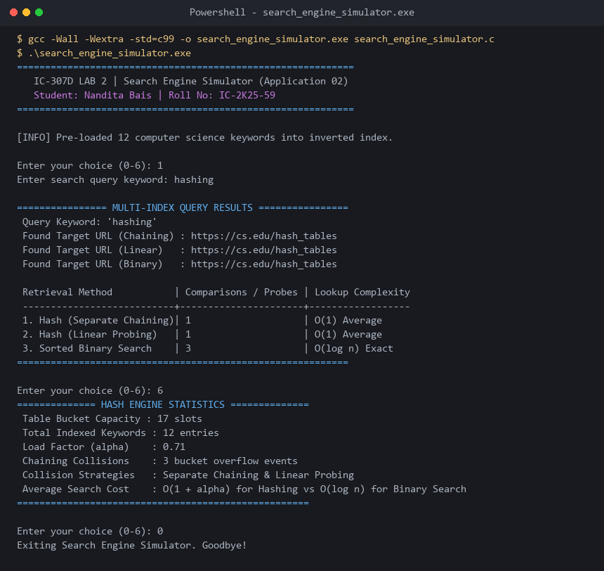

# Application 02: Search Engine Simulator (Hashing & Binary Search)

**Course:** IC-307D Data Structures and Algorithms LAB  
**Student:** Nandita Bais | **Roll Number:** IC-2K25-59  
**Source Code:** [`search_engine_simulator.c`](search_engine_simulator.c)

---

## 1. System Overview
A search engine keyword-URL inverted index demonstrating and contrasting:
1. Hash Table with Separate Chaining (Linked Lists): $O(1)$ average lookup.
2. Hash Table with Linear Probing (Open Addressing): $O(1)$ average lookup.
3. Alphabetically Sorted Inverted Index with Binary Search: $O(\log n)$ exact lookup.

---

## 2. Sample Execution & Verified Screenshot

