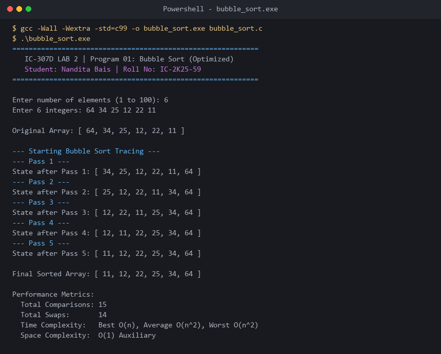

# Program 01: Bubble Sort (Optimized with Pass Tracing)

**Course:** IC-307D Data Structures and Algorithms LAB  
**Student:** Nandita Bais | **Roll Number:** IC-2K25-59  
**Source Code:** [`bubble_sort.c`](bubble_sort.c)

---

## 1. Problem Statement
Implement an optimized Bubble Sort algorithm in C with:
1. Pass-by-pass tracing of array states.
2. An early-exit swap flag (`swapped`) to achieve $O(n)$ best-case time on pre-sorted inputs.
3. Accurate comparison and swap metric counting.

---

## 2. Algorithm & Pseudocode

```c
procedure BUBBLE_SORT(arr, n):
    for i from 0 to n - 2 do:
        swapped = false
        for j from 0 to n - 2 - i do:
            if arr[j] > arr[j + 1] then:
                swap(arr[j], arr[j + 1])
                swapped = true
        if not swapped then break // Early exit optimization
```

---

## 3. Complexity Analysis
- **Best Case:** $O(n)$ (Pre-sorted array triggers early termination on Pass 1).
- **Average Case:** $O(n^2)$ (Average $\frac{n(n-1)}{2}$ comparisons).
- **Worst Case:** $O(n^2)$ (Reverse-sorted array requires full $n-1$ passes and maximum swaps).
- **Auxiliary Space:** $O(1)$ in-place.
- **Stability:** Stable.

---

## 4. Sample Execution & Verified Screenshot


