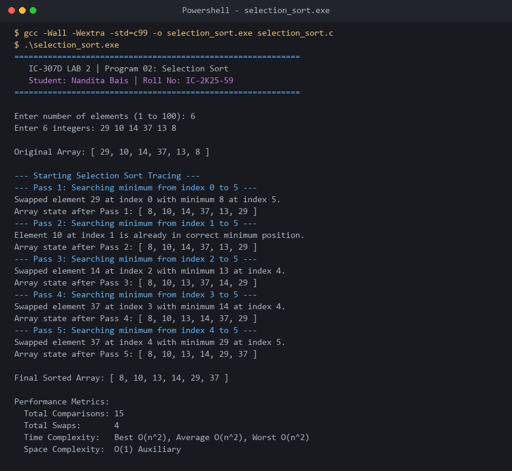

# Program 02: Selection Sort (With Pass Tracing)

**Course:** IC-307D Data Structures and Algorithms LAB  
**Student:** Nandita Bais | **Roll Number:** IC-2K25-59  
**Source Code:** [`selection_sort.c`](selection_sort.c)

---

## 1. Problem Statement
Implement Selection Sort in C with pass-by-pass tracing and swap counting.

## 2. Complexity Analysis
- **Best / Average / Worst Case:** $\Theta(n^2)$ comparisons regardless of initial ordering.
- **Swaps:** At most $n - 1$ swaps (optimal when write operations to memory are costly, e.g., EEPROM/Flash).
- **Auxiliary Space:** $O(1)$.
- **Stability:** Unstable.

---

## 3. Sample Execution & Verified Screenshot

