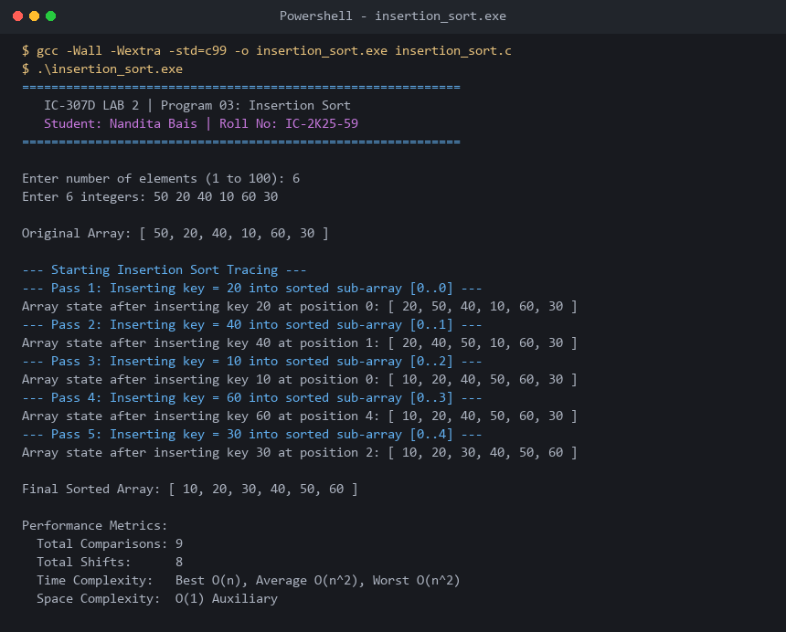

# Program 03: Insertion Sort (With Shift Tracing)

**Course:** IC-307D Data Structures and Algorithms LAB  
**Student:** Nandita Bais | **Roll Number:** IC-2K25-59  
**Source Code:** [`insertion_sort.c`](insertion_sort.c)

---

## 1. Problem Statement
Implement Insertion Sort in C, maintaining a sorted prefix $[0 \dots i-1]$ and inserting the key element into its proper position using rightward shifts.

## 2. Complexity Analysis
- **Best Case:** $O(n)$ (Pre-sorted input requires 1 comparison per element and 0 shifts).
- **Average Case:** $O(n^2)$.
- **Worst Case:** $O(n^2)$ (Reverse sorted input requires maximum shifts).
- **Auxiliary Space:** $O(1)$.
- **Stability:** Stable.
- **Adaptivity:** Highly adaptive (ideal for small or nearly sorted arrays).

---

## 3. Sample Execution & Verified Screenshot

