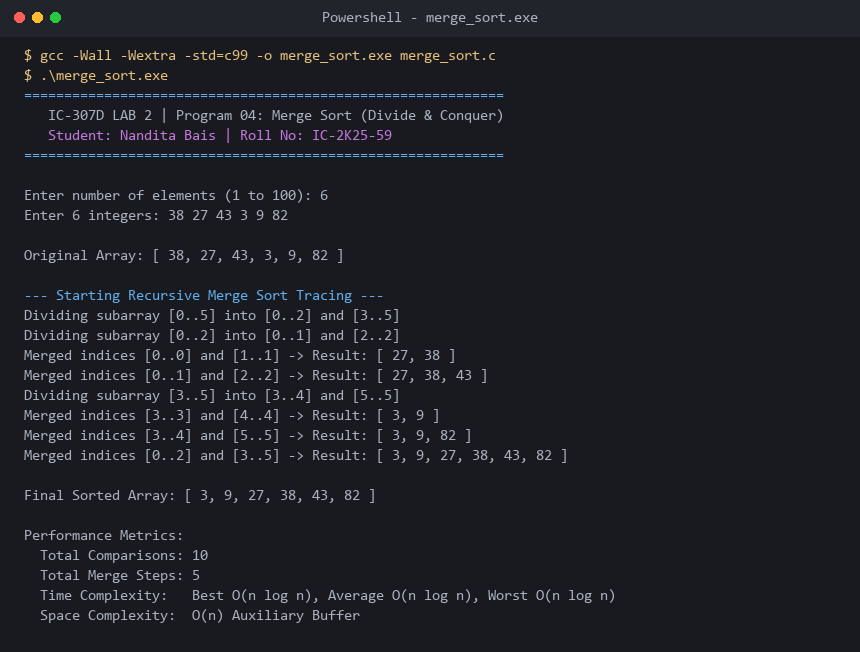

# Program 04: Merge Sort (Divide and Conquer)

**Course:** IC-307D Data Structures and Algorithms LAB  
**Student:** Nandita Bais | **Roll Number:** IC-2K25-59  
**Source Code:** [`merge_sort.c`](merge_sort.c)

---

## 1. Problem Statement
Implement a recursive Divide and Conquer Merge Sort in C with step-by-step division and merging tracing.

## 2. Recurrence & Master Theorem
$$T(n) = 2T(n/2) + \Theta(n)$$
Applying Case 2 of the Master Theorem ($a=2, b=2, f(n)=\Theta(n)$):
$$T(n) = \Theta(n \log n) \quad \text{guaranteed across Best, Average, and Worst cases.}$$

## 3. Complexity Analysis
- **Time Complexity:** $O(n \log n)$ Best, Average, Worst.
- **Auxiliary Space:** $O(n)$ for auxiliary merge buffers.
- **Stability:** Stable.

---

## 4. Sample Execution & Verified Screenshot

