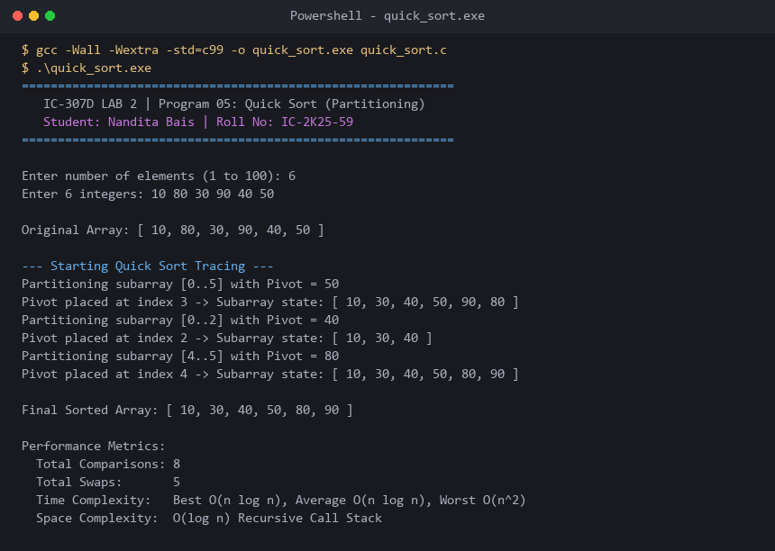

# Program 05: Quick Sort (Partitioning Analysis)

**Course:** IC-307D Data Structures and Algorithms LAB  
**Student:** Nandita Bais | **Roll Number:** IC-2K25-59  
**Source Code:** [`quick_sort.c`](quick_sort.c)

---

## 1. Problem Statement
Implement Quick Sort in C utilizing Lomuto partitioning, pivot tracking, and recursion tracing.

## 2. Complexity Analysis
- **Best / Average Time:** $O(n \log n)$ with balanced partitions.
- **Worst Case Time:** $O(n^2)$ when pivot is continuously the extreme element (mitigated via median-of-three pivot selection).
- **Auxiliary Space:** $O(\log n)$ call stack frames.
- **Stability:** Unstable.

---

## 3. Sample Execution & Verified Screenshot

