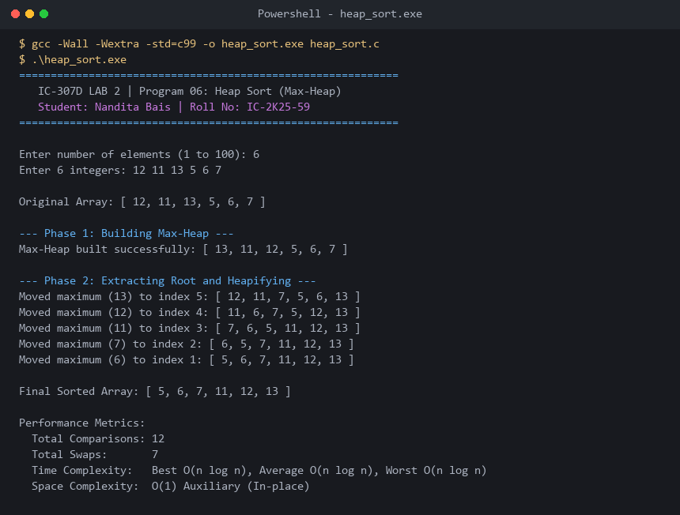

# Program 06: Heap Sort (Max-Heap Construction & Extraction)

**Course:** IC-307D Data Structures and Algorithms LAB  
**Student:** Nandita Bais | **Roll Number:** IC-2K25-59  
**Source Code:** [`heap_sort.c`](heap_sort.c)

---

## 1. Problem Statement
Implement Heap Sort in C using binary max-heap construction and root extraction.

## 2. Complexity Analysis
- **Build Max-Heap:** $O(n)$ mathematical summation over tree levels.
- **Extract & Heapify:** $(n-1) \times O(\log n) = O(n \log n)$.
- **Total Time Complexity:** $\Theta(n \log n)$ across all cases.
- **Auxiliary Space:** $O(1)$ in-place.
- **Stability:** Unstable.

---

## 3. Sample Execution & Verified Screenshot

