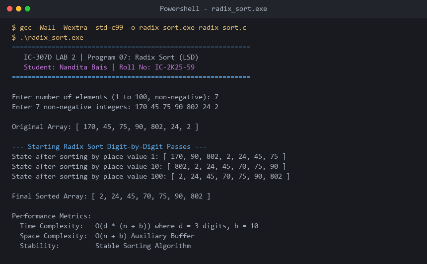

# Program 07: Radix Sort (LSD Non-Comparison Sorting)

**Course:** IC-307D Data Structures and Algorithms LAB  
**Student:** Nandita Bais | **Roll Number:** IC-2K25-59  
**Source Code:** [`radix_sort.c`](radix_sort.c)

---

## 1. Problem Statement
Implement Least Significant Digit (LSD) Radix Sort in C using stable Counting Sort as the digit-level subroutine.

## 2. Complexity Analysis
- **Time Complexity:** $O(d \times (n + b))$ where $d$ is maximum number of digits and $b=10$ is the number base.
- **Auxiliary Space:** $O(n + b)$.
- **Stability:** Guaranteed Stable.

---

## 3. Sample Execution & Verified Screenshot

