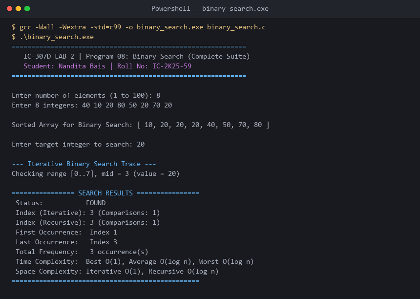

# Program 08: Binary Search (Iterative, Recursive & Bounds)

**Course:** IC-307D Data Structures and Algorithms LAB  
**Student:** Nandita Bais | **Roll Number:** IC-2K25-59  
**Source Code:** [`binary_search.c`](binary_search.c)

---

## 1. Problem Statement
Implement both iterative and recursive Binary Search in C, alongside lower-bound (first occurrence) and upper-bound (last occurrence) routines to find duplicate element frequencies.

## 2. Complexity Analysis
- **Best Case:** $O(1)$ (Target located at exact midpoint).
- **Average / Worst Case:** $O(\log n)$.
- **Auxiliary Space:** Iterative: $O(1)$ / Recursive: $O(\log n)$.

---

## 3. Sample Execution & Verified Screenshot

