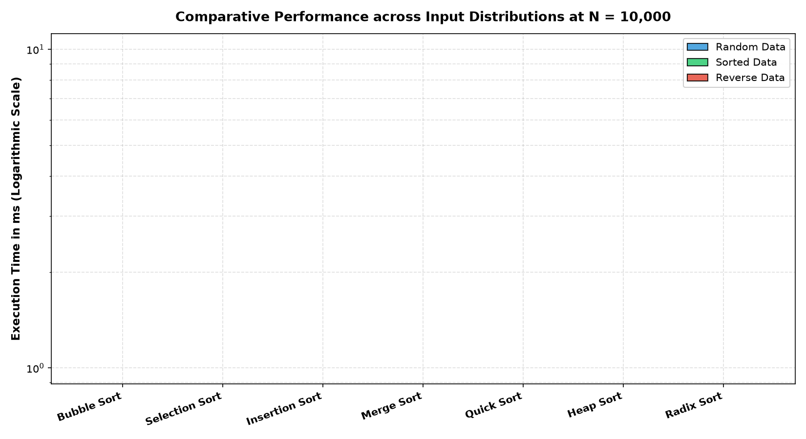
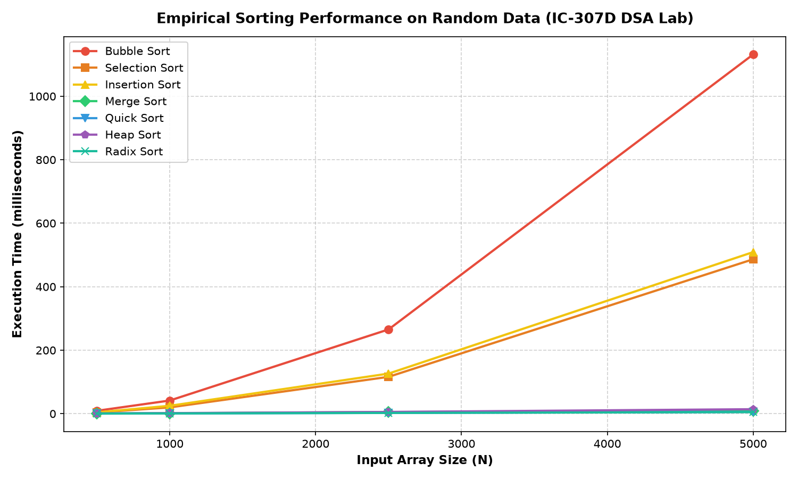
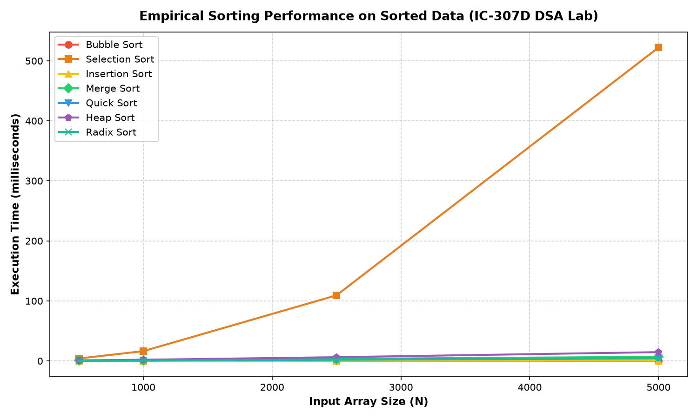
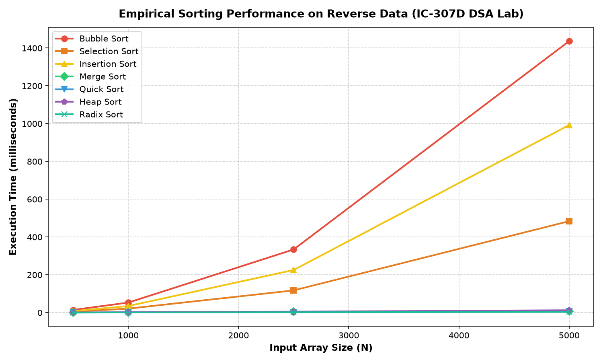

# Empirical Sorting Benchmark Suite

**Course:** IC-307D Data Structures and Algorithms LAB  
**Student:** Nandita Bais | **Roll Number:** IC-2K25-59  
**Source Code:** [`benchmark_sorting.c`](benchmark_sorting.c) | [`plot_benchmarks.py`](plot_benchmarks.py)

---

## 1. Overview
Empirically evaluates 7 sorting algorithms across array sizes $N \in \{500, 1000, 2500, 5000\}$ on:
1. Random Uniform Data
2. Pre-Sorted Ascending Data
3. Reverse-Sorted Descending Data

Timings are collected and plotted using Python and Matplotlib.

---

## 2. Comparative Benchmark Visualizations

### Overall Logarithmic Summary (N = 5000)

### Performance on Random Data

### Performance on Sorted Data

### Performance on Reverse-Sorted Data

