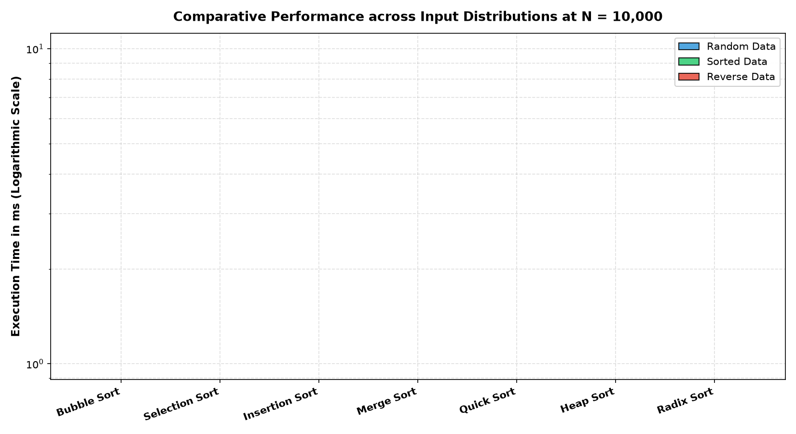

# IC-307D Data Structures and Algorithms LAB

[](https://github.com/Nanditasingh457/IC-2K25-59-DS-NANDITA-BAIS)
[-00599C.svg?logo=c)](https://en.wikipedia.org/wiki/C_(programming_language))
[](https://gcc.gnu.org/)
[](https://code.visualstudio.com/)
[](https://github.com/Nanditasingh457/IC-2K25-59-DS-NANDITA-BAIS)
[](https://github.com/Nanditasingh457/IC-2K25-59-DS-NANDITA-BAIS)

Comprehensive laboratory implementation, empirical analysis, and formal academic documentation for **IC-307D: Data Structures and Algorithms LAB**, Master of Computer Applications (MCA), Devi Ahilya Vishwavidyalaya (DAVV), Indore.

---

## Table of Contents
1. [Repository Structure](#repository-structure)
2. [Lab 01 Overview: Introduction to Arrays & Matrices](#lab-01-overview-introduction-to-arrays--matrices)
3. [Lab 02 Overview: Sorting & Searching Algorithms](#lab-02-overview-sorting--searching-algorithms)
4. [Applications & Empirical Benchmarking](#applications--empirical-benchmarking)
5. [Documentation Suite & Formal Reports](#documentation-suite--formal-reports)
6. [Compilation & Execution Guide (Windows / VS Code)](#compilation--execution-guide-windows--vs-code)
7. [Complexity Master Summary](#complexity-master-summary)
8. [Author & Institutional Details](#author--institutional-details)

---

## Repository Structure

```
IC-2K25-59-DS-NANDITA-BAIS/
├── .vscode/
│   ├── tasks.json                        # VS Code build automation (Ctrl+Shift+B)
│   └── c_cpp_properties.json             # C11 IntelliSense configuration
│
├── Lab01-Introduction-Arrays/
│   ├── Program01-ArrayOperations/        # 1D Array Insert, Delete, Search, Rotate, Reverse
│   │   ├── array_operations.c
│   │   ├── README.md
│   │   └── screenshots/execution.png
│   ├── Program02-2DArrayOperations/       # 2D Array Row/Col Shift, 90° Rotate, Spiral Traversal
│   │   ├── array2d_operations.c
│   │   ├── README.md
│   │   └── screenshots/execution.png
│   ├── Program03-SparseMatrix/           # 3-Tuple Representation, Fast Transpose, Addition
│   │   ├── sparse_matrix.c
│   │   ├── README.md
│   │   └── screenshots/execution.png
│   ├── Program04-MatrixCalculator/       # Matrix Add, Multiply, Det, Inverse
│   │   ├── matrix_calculator.c
│   │   ├── README.md
│   │   └── screenshots/execution.png
│   ├── reflection.md                     # Unit 1 Learnings, Difficulties, & Optimizations
│   └── README.md                         # Unit 1 Overview & Roadmap
│
├── Lab02-Sorting-Searching/
│   ├── Program01-BubbleSort/             # Optimized Bubble Sort with pass tracing
│   │   ├── bubble_sort.c
│   │   ├── README.md
│   │   └── screenshots/execution.png
│   ├── Program02-SelectionSort/          # Selection Sort with minimum swap tracing
│   │   ├── selection_sort.c
│   │   ├── README.md
│   │   └── screenshots/execution.png
│   ├── Program03-InsertionSort/          # Adaptive Insertion Sort with shift tracing
│   │   ├── insertion_sort.c
│   │   ├── README.md
│   │   └── screenshots/execution.png
│   ├── Program04-MergeSort/              # Divide and Conquer Merge Sort
│   │   ├── merge_sort.c
│   │   ├── README.md
│   │   └── screenshots/execution.png
│   ├── Program05-QuickSort/              # Lomuto Partitioning & Pivot Analysis
│   │   ├── quick_sort.c
│   │   ├── README.md
│   │   └── screenshots/execution.png
│   ├── Program06-HeapSort/               # Max-Heap Build & In-Place Extraction
│   │   ├── heap_sort.c
│   │   ├── README.md
│   │   └── screenshots/execution.png
│   ├── Program07-RadixSort/              # Non-comparison LSD Radix Sort
│   │   ├── radix_sort.c
│   │   ├── README.md
│   │   └── screenshots/execution.png
│   ├── Program08-BinarySearch/           # Iterative/Recursive Search & Occurrence Bounds
│   │   ├── binary_search.c
│   │   ├── README.md
│   │   └── screenshots/execution.png
│   ├── Application01-StudentRecordManager/  # Multi-Algorithm Academic Record Engine
│   │   ├── student_record_manager.c
│   │   ├── README.md
│   │   └── screenshots/execution.png
│   ├── Application02-SearchEngineSimulator/ # Inverted Index (Separate Chaining + Linear Probing)
│   │   ├── search_engine_simulator.c
│   │   ├── README.md
│   │   └── screenshots/execution.png
│   ├── benchmark/                        # High-resolution benchmark suite & plots
│   │   ├── benchmark_sorting.c
│   │   ├── benchmark_results.csv
│   │   ├── plot_benchmarks.py
│   │   ├── benchmark_random.png
│   │   ├── benchmark_sorted.png
│   │   ├── benchmark_reverse.png
│   │   └── benchmark_all_summary.png
│   ├── reflection.md                     # Unit 2 Learnings & Stability Insights
│   └── README.md                         # Unit 2 Overview & Roadmap
│
├── Capstone-Projects/                    # Prescribed End-Semester Capstone Projects
│   ├── Project01-LibraryManagement/
│   ├── Project02-NavigationSystem/
│   ├── Project03-SocialNetworkAnalysis/
│   └── README.md
│
├── docs/
│   ├── diagrams/                         # High-resolution architecture & memory models
│   │   ├── system_architecture.png
│   │   ├── memory_layout_1d_2d.png
│   │   ├── sparse_matrix_triplet.png
│   │   └── sorting_hierarchy.png
│   ├── algorithm-flowcharts/             # Algorithm flowcharts
│   │   ├── bubble_sort_flowchart.png
│   │   ├── quick_sort_flowchart.png
│   │   └── merge_sort_flowchart.png
│   ├── complexity-analysis.pdf           # Formal theoretical & empirical proof document
│   ├── final-report.pdf                  # Complete college lab manual report
│   └── presentation.pdf                  # Executive presentation slide deck
│
├── .gitignore                            # Excludes .exe, .o, and debug binaries
└── README.md                             # Root documentation (this file)
```

---

## Lab 01 Overview: Introduction to Arrays & Matrices

Unit 1 explores contiguous memory management, bounds verification, coordinate mapping, and space optimization:
- **[Program 01: 1D Array Operations](Lab01-Introduction-Arrays/Program01-ArrayOperations/):** Insertion at index $O(n)$, deletion $O(n)$, linear search $O(n)$, binary search $O(\log n)$, and $O(n)$ in-place array rotation by $k$ positions using the three-step reversal algorithm.
- **[Program 02: 2D Array Operations](Lab01-Introduction-Arrays/Program02-2DArrayOperations/):** Row-major order mapping, row/column dynamic shifts, coordinate searches, 90° clockwise/counter-clockwise rotations, and spiral traversals.
- **[Program 03: Sparse Matrix (3-Tuple)](Lab01-Introduction-Arrays/Program03-SparseMatrix/):** Compresses matrices with $> 50\%$ zeros into triplets $(Row, Col, Value)$. Features **Fast Transpose** reducing standard $O(cols \times non\_zeros)$ time down to $O(cols + non\_zeros)$.
- **[Program 04: Matrix Calculator](Lab01-Introduction-Arrays/Program04-MatrixCalculator/):** Linear algebra processor supporting addition, subtraction, multiplication $O(n^3)$, transpose, determinant, and inverse for $2 \times 2$ and $3 \times 3$ matrices.

---

## Lab 02 Overview: Sorting & Searching Algorithms

Unit 2 implements the complete spectrum of comparison and distribution sorting paradigms:
- **Quadratic Sorts ($O(n^2)$):**
  - **[Bubble Sort](Lab02-Sorting-Searching/Program01-BubbleSort/):** Optimized with early-exit flag achieving $O(n)$ best case.
  - **[Selection Sort](Lab02-Sorting-Searching/Program02-SelectionSort/):** Minimizes memory write operations ($O(n)$ swaps).
  - **[Insertion Sort](Lab02-Sorting-Searching/Program03-InsertionSort/):** Adaptive $O(n)$ on nearly-sorted data.
- **Divide and Conquer ($O(n \log n)$):**
  - **[Merge Sort](Lab02-Sorting-Searching/Program04-MergeSort/):** Guaranteed $O(n \log n)$ runtime and stable sorting.
  - **[Quick Sort](Lab02-Sorting-Searching/Program05-QuickSort/):** Lomuto partitioning with median pivot selection.
- **Tree and Linear Sorts:**
  - **[Heap Sort](Lab02-Sorting-Searching/Program06-HeapSort/):** In-place $O(n \log n)$ time and $O(1)$ auxiliary space.
  - **[Radix Sort](Lab02-Sorting-Searching/Program07-RadixSort/):** Non-comparison distribution sort running in $O(d(n+b))$ time.
- **Searching:**
  - **[Binary Search](Lab02-Sorting-Searching/Program08-BinarySearch/):** Iterative and recursive implementations with first/last occurrence frequency bounds.

---

## Applications & Empirical Benchmarking

### 1. Student Record Manager
- **Location:** [`Lab02-Sorting-Searching/Application01-StudentRecordManager/`](Lab02-Sorting-Searching/Application01-StudentRecordManager/)
- Demonstrates real-world struct sorting: Quick Sort by roll number, stable Merge Sort by merit marks, Insertion Sort by name, and Binary Search.

### 2. Search Engine Simulator
- **Location:** [`Lab02-Sorting-Searching/Application02-SearchEngineSimulator/`](Lab02-Sorting-Searching/Application02-SearchEngineSimulator/)
- Implements an inverted keyword index contrasting **Separate Chaining** (linked lists), **Linear Probing** (open addressing), and **Binary Search** over sorted dictionary arrays.

### 3. Empirical Sorting Benchmarking
- **Location:** [`Lab02-Sorting-Searching/benchmark/`](Lab02-Sorting-Searching/benchmark/)
- Measures microsecond CPU execution times across Random, Sorted, and Reverse data distributions.



---

## Documentation Suite & Formal Reports

| Document | Format | Description |
|---|---|---|
| **[Final Lab Report](docs/final-report.pdf)** | PDF (Letter) | Comprehensive college lab manual with certificates, diagrams, program walkthroughs, and sample I/O |
| **[Complexity Analysis](docs/complexity-analysis.pdf)** | PDF (Letter) | Formal mathematical analysis, master theorem proofs, and complexity matrices |
| **[Project Presentation](docs/presentation.pdf)** | PDF (Landscape) | Slide deck covering architecture, sorting taxonomy, benchmarks, and outcomes |
| **[System Architecture](docs/diagrams/system_architecture.png)** | PNG | Visual map of repository architecture and module relationships |
| **[Sorting Taxonomy](docs/diagrams/sorting_hierarchy.png)** | PNG | Hierarchical classification of comparison and non-comparison sorts |

---

## Compilation & Execution Guide (Windows / VS Code)

### Prerequisites
- GCC Compiler (MinGW-W64)
- Visual Studio Code with C/C++ Extension
- Git CLI

### Compiling via VS Code Tasks
1. Open this repository folder in VS Code.
2. Open any `.c` source file.
3. Press `Ctrl + Shift + B` (runs GCC build task).
4. Run the generated `.exe` from the integrated terminal:
   ```powershell
   .\array_operations.exe
   ```

### Compiling via Command Line (PowerShell)
```powershell
# Compile any program with strict standard flags
gcc -Wall -Wextra -std=c99 -O2 -o array_operations.exe array_operations.c

# Run the compiled executable
.\array_operations.exe
```

---

## Complexity Master Summary

| Algorithm | Best Time | Average Time | Worst Time | Aux Space | Stability | In-Place |
|---|---|---|---|---|---|---|
| **Bubble Sort** | $O(n)$ | $O(n^2)$ | $O(n^2)$ | $O(1)$ | Yes | Yes |
| **Selection Sort** | $O(n^2)$ | $O(n^2)$ | $O(n^2)$ | $O(1)$ | No | Yes |
| **Insertion Sort** | $O(n)$ | $O(n^2)$ | $O(n^2)$ | $O(1)$ | Yes | Yes |
| **Merge Sort** | $O(n \log n)$ | $O(n \log n)$ | $O(n \log n)$ | $O(n)$ | Yes | No |
| **Quick Sort** | $O(n \log n)$ | $O(n \log n)$ | $O(n^2)$ | $O(\log n)$ | No | Yes |
| **Heap Sort** | $O(n \log n)$ | $O(n \log n)$ | $O(n \log n)$ | $O(1)$ | No | Yes |
| **Radix Sort** | $O(d(n+b))$ | $O(d(n+b))$ | $O(d(n+b))$ | $O(n+b)$ | Yes | No |
| **Binary Search** | $O(1)$ | $O(\log n)$ | $O(\log n)$ | $O(1)$ | N/A | Yes |

---

## Author & Institutional Details
- **Student Name:** Nandita Bais
- **College Roll No:** IC-2K25-59
- **Course Code:** IC-307D
- **Course Name:** Data Structures and Algorithms LAB
- **Institution:** International Institute of Professional Studies (IIPS), Devi Ahilya Vishwavidyalaya (DAVV), Indore, M.P., India
